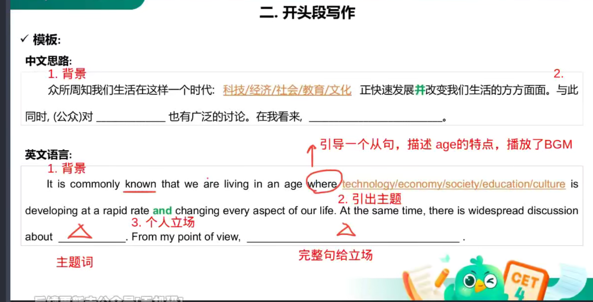
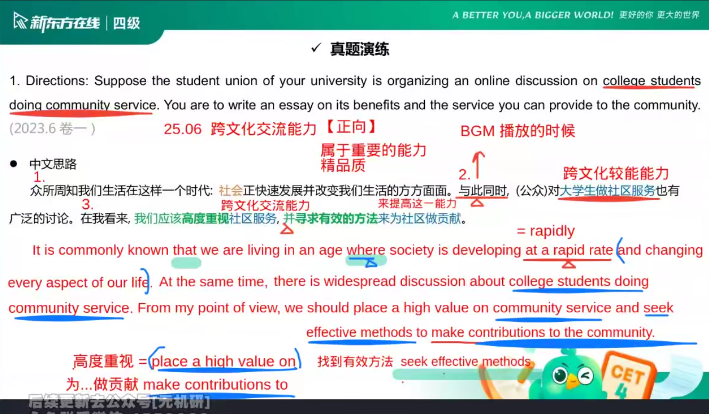
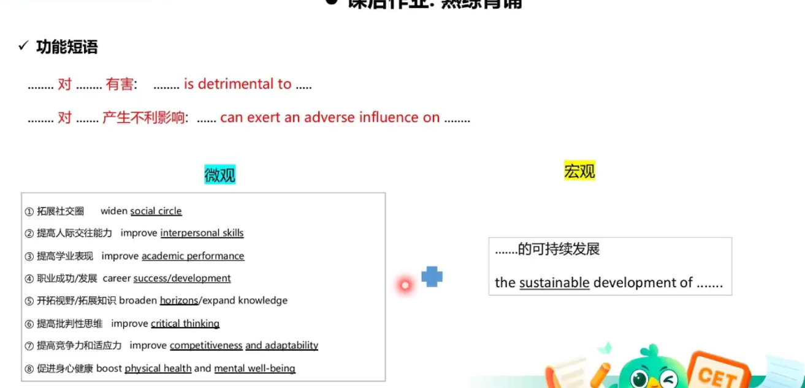

# 作文必背

> [!info] 使用说明
> 本笔记来自四级作文课件素材（新东方在线真题演练），含 **开头段万能模板**、**真题范文**、**功能短语清单** 三部分。
> 用法：模板背熟 → 范文精读 → 短语替换，考前反复默写。

---

## 一、开头段写作模板（背到能默写）

**中文思路三步走**：① 背景 → ② 引出主题 → ③ 个人立场

**英文模板**：

> It is commonly known that we are living in an age where **technology / economy / society / education / culture** is developing **at a rapid rate** and changing every aspect of our life. At the same time, there is widespread discussion about **____**. From my point of view, **____**.

- 语法要点：`where` 引导从句，描述 age 的特点
- `____` ① 填**主题词**（名词短语）；`____` ② 填**完整句**（明确个人立场）
- 划线的 5 个主题词按题目替换：科技/经济/社会/教育/文化

---

## 二、2023 年 6 月卷一真题范文（社区服务）

**题目**：Suppose the student union of your university is organizing an online discussion on college students doing community service. You are to write an essay on its benefits and the service you can provide to the community.

**中文思路**：社会快速发展 → 公众对大学生做社区服务有广泛讨论 → 在我看来应高度重视社区服务，并寻求有效方法为社区做贡献。

**英文范文**：

> It is commonly known that we are living in an age where society is developing at a rapid rate and changing every aspect of our life. At the same time, there is widespread discussion about college students doing community service. From my point of view, we should place a high value on community service and seek effective methods to make contributions to the community.

**同义替换（重点记忆）**：

| 中文 | 高分表达 | 替换掉 |
|---|---|---|
| 快速发展 | develop at a rapid rate | rapidly |
| 高度重视 | place a high value on | value |
| 找到有效方法 | seek effective methods | find ways |
| 为…做贡献 | make contributions to | help |

> [!tip] 考点提示
> 25.06 跨文化交流能力【正向】——社区服务话题常与"提升跨文化交流能力"挂钩，可作延伸论点。

---

## 三、功能短语背诵清单（课后作业：熟练背诵）

### 负面表达
- ……对……有害：**……is detrimental to ……**
- ……对……产生不利影响：**……can exert an adverse influence on ……**

### 微观层面 · 个人能力提升（积极）
| 中文 | 英文 |
|---|---|
| 拓展社交圈 | widen social circle |
| 提高人际交往能力 | improve interpersonal skills |
| 提高学业表现 | improve academic performance |
| 职业成功/发展 | career success / development |
| 开拓视野/拓展知识 | broaden horizons / expand knowledge |
| 提高批判性思维 | improve critical thinking |
| 提高竞争力和适应力 | improve competitiveness and adaptability |
| 促进身心健康 | boost physical health and mental well-being |

### 宏观层面 · 可持续发展
- ……的可持续发展：**the sustainable development of ……**

---

> [!quote] 背诵节奏建议
> 模板每天默写 1 遍（10 分钟内完成开头段）→ 短语每 3 天过 1 轮 → 考前 2 周把范文背到能逐句复述。
